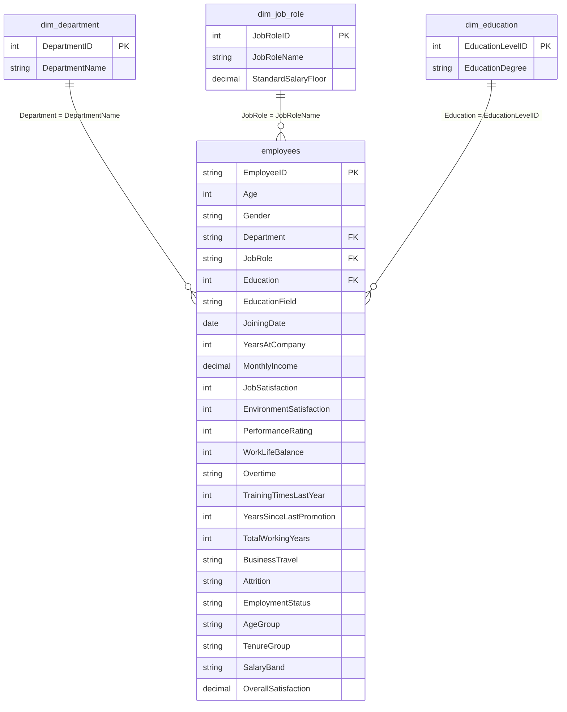

# Power BI Dashboard Specification & Implementation Guide

**Project:** HR Employee Analytics Dashboard  
**Report Architecture:** 4 Comprehensive Analytical Pages  
**Design Standard:** Enterprise Corporate BI (Microsoft Power BI Desktop)  
**Author:** Senior BI Developer & Data Analyst

---

## 1. Global Visual Theme & Corporate Style Guide

### Color Palette (Hex Codes)
| Color Role | Hex Code | Visual Application |
| :--- | :--- | :--- |
| **Primary Navy** | `#1E3A8A` | Primary headers, main KPI values, default bar fills |
| **Secondary Teal** | `#0D9488` | Active employee counts, retention bars, positive trends |
| **Alert Red** | `#DC2626` | Attrition rates, departed headcount, flight risk warnings |
| **Warm Amber** | `#F59E0B` | Medium risk, non-binary gender, tenure milestone markers |
| **Neutral Slate** | `#475569` | Axis titles, chart subtitles, data label annotations |
| **Canvas Background** | `#F1F5F9` | Clean off-white background ensuring high visual contrast |
| **Card / Visual Tile** | `#FFFFFF` | Card containers with subtle border radius (4px) and soft shadow |

### Typography Standard
- **Report Title:** Segoe UI, 20pt, Bold, `#0F172A`
- **Page Section Headers:** Segoe UI Semibold, 14pt, `#1E293B`
- **KPI Display Values:** Segoe UI Bold, 24pt, `#1E3A8A`
- **KPI Category Labels:** Segoe UI, 10pt, `#64748B`
- **Visual Chart Titles:** Segoe UI Semibold, 12pt, `#0F172A`
- **Axis & Data Labels:** Segoe UI, 9pt - 10pt, Regular, `#475569`

### Canvas Grid & Dimensions
- **Page Size:** 16:9 Standard Widescreen (1280px × 720px)
- **Top Header Banner:** 1280px × 60px (`#1E3A8A` deep navy background with white text and company logo)
- **Left Slicer Panel:** 220px width on each page for unified, persistent filtering
- **Main Visual Canvas:** 1040px × 640px grid

---

## 2. Interactive Global Slicers (Standard Left Filter Pane)
On all 4 pages, configure the persistent left sidebar with the following slicers:
1. **Department Slicer:** Dropdown or Vertical List (`employees[Department]`, Single/Multi-select with 'Select All')
2. **Gender Slicer:** Tile or Dropdown (`employees[Gender]`)
3. **Job Role Slicer:** Searchable Dropdown (`employees[JobRole]`)
4. **Age Group Slicer:** Vertical List (`employees[AgeGroup]`: `<25`, `25-34`, `35-44`, `45-54`, `55+`)
5. **Attrition Status Slicer:** Tile (`employees[Attrition]`: `Yes` / `No`)

---

## 3. Page 1: HR Executive Overview

### Page Objective
Provides the Chief Human Resources Officer (CHRO) and senior executives with an immediate high-level snapshot of organizational workforce volume, attrition rate, payroll, and divisional distribution.

```
+--------------------------------------------------------------------------------------------------------+
| TOP BANNER: HR Executive Overview | Last Refreshed: Current Date | Filter Status: All Departments       |
+--------------------------------------------------------------------------------------------------------+
| [FILTERS]    | [KPI 1]          | [KPI 2]          | [KPI 3]        | [KPI 4]      | [KPI 5]   | [KPI 6]   |
| Department   | Total Employees  | Active Employees | Attrition Count| Attrition %  | Avg Salary| Avg Age   |
| Gender       | 5,000            | 4,348            | 652            | 13.0%        | $10,017   | 37.0 Yrs  |
| Job Role     +-----------------------------------------------------------------------------------------+
| Age Group    | Visual 1: Headcount by Department           | Visual 2: Gender Diversity Donut          |
| Attrition    | Clustered Column Chart                      | Donut Chart                               |
|              +---------------------------------------------+-------------------------------------------+
|              | Visual 3: Annual Hiring Growth Trend        | Visual 4: Employment Status Ratio         |
|              | Area / Line Chart (Hires over JoiningDate)  | Stacked 100% Bar Chart                    |
+--------------------------------------------------------------------------------------------------------+
```

### Visual Specifications
1. **KPI Card 1 - Total Employees:** Measure `[Total Employees]`, Display unit: None (`5,000`).
2. **KPI Card 2 - Active Employees:** Measure `[Active Employees]`, Display unit: None (`4,348`).
3. **KPI Card 3 - Attrition Count:** Measure `[Attrition Count]`, Accent color: `#DC2626` (`652`).
4. **KPI Card 4 - Attrition Rate:** Measure `[Attrition Rate]`, Format: `0.0%` (`13.0%`).
5. **KPI Card 5 - Average Monthly Salary:** Measure `[Average Monthly Income]`, Format: Currency (`$10,017`).
6. **KPI Card 6 - Average Employee Age:** Measure `[Average Age]`, Suffix: `Years` (`37.0`).
7. **Visual 1 (Clustered Column Chart):**
   - **X-axis:** `employees[Department]`
   - **Y-axis:** `[Total Employees]`
   - **Data Labels:** On, Position: Outside End, Font: Segoe UI Bold 10pt.
   - **Color:** Corporate Navy `#1E3A8A`.
8. **Visual 2 (Donut Chart):**
   - **Legend:** `employees[Gender]`
   - **Values:** `[Total Employees]`
   - **Colors:** Male (`#1E3A8A`), Female (`#0D9488`), Non-Binary (`#F59E0B`).
   - **Detail Labels:** Category + Percent of Total.
9. **Visual 3 (Line / Area Chart):**
   - **X-axis:** `employees[JoiningDate]` (Year hierarchy)
   - **Y-axis:** `[Total Employees]`
   - **Title:** "Cumulative Workforce Intake Velocity (Year-over-Year)"
10. **Visual 4 (Stacked Bar Chart):**
    - **Y-axis:** `employees[Department]`
    - **X-axis:** `[Total Employees]`
    - **Legend:** `employees[EmploymentStatus]` (Active: `#0D9488`, Terminated: `#DC2626`).

---

## 4. Page 2: Attrition Analysis

### Page Objective
Equips Talent Retention teams and HR business partners to diagnose voluntary employee departure patterns across departments, job roles, overtime burdens, and service tenure.

### Visual Specifications
1. **Top Metric Strip:**
   - **Overall Attrition Rate:** `[Attrition Rate]` (`13.0%`)
   - **Overtime Attrition Rate:** `[Overtime Attrition Rate]` (`19.7%`)
   - **Non-Overtime Attrition Rate:** `[Non-Overtime Attrition Rate]` (`10.4%`)
   - **Early Tenure Attrition Rate (<=2 Yrs):** `[Early Tenure Attrition Rate]` (`14.8%`)
2. **Visual 1: Attrition Rate by Department (Clustered Bar Chart)**
   - **X-axis:** `employees[Department]`
   - **Y-axis:** `[Attrition Rate]`
   - **Benchmark Line:** Constant line at overall attrition (`13.0%`).
   - **Conditional Formatting:** Fill `#DC2626` if >= `[Attrition Rate]`, else `#0D9488`.
3. **Visual 2: Attrition by Job Role (Horizontal Bar Chart)**
   - **Y-axis:** `employees[JobRole]` (Sorted descending by attrition rate)
   - **X-axis:** `[Attrition Rate]`
   - **Highlights:** Sales Representative and Laboratory Technician flagged as critical churn roles.
4. **Visual 3: Attrition by Overtime Status (100% Stacked Column Chart)**
   - **X-axis:** `employees[Overtime]` (`No`, `Yes`)
   - **Y-axis:** `[Total Employees]`
   - **Legend:** `employees[Attrition]` (`No`: `#0D9488`, `Yes`: `#DC2626`)
   - **Key Finding:** Employees working overtime experience nearly 2x higher attrition!
5. **Visual 4: Attrition Rate by Age Cohort (Clustered Column Chart)**
   - **X-axis:** `employees[AgeGroup]` (`<25`, `25-34`, `35-44`, `45-54`, `55+`)
   - **Y-axis:** `[Attrition Rate]`
   - **Insight:** Early-career (<25) workers show heightened flight risk.
6. **Visual 5: Attrition by Years at Company (Line & Ribbon Chart)**
   - **X-axis:** `employees[YearsAtCompany]` (0 to 15 years)
   - **Y-axis:** `[Attrition Count]` & `[Attrition Rate]`
   - **Insight:** First 2 years account for the largest proportion of departures.

---

## 5. Page 3: Salary and Workforce Analysis

### Page Objective
Assists Compensation and Benefits (C&B) committees in reviewing pay equity, experience-to-salary ratios, and educational background dynamics.

### Visual Specifications
1. **Top Metric Strip:**
   - **Average Monthly Salary:** `[Average Monthly Income]` (`$10,017`)
   - **Median Monthly Salary:** `[Median Monthly Income]` (`$8,655`)
   - **Total Monthly Payroll:** `[Total Monthly Payroll]` (`$50.08M`)
   - **Gender Pay Parity Ratio:** `[Gender Pay Parity Ratio]` (`0.99` - equitable)
2. **Visual 1: Salary Distribution by Department (Clustered Column Chart)**
   - **X-axis:** `employees[Department]`
   - **Y-axis:** `[Average Monthly Income]` & `[Median Monthly Income]`
   - **Data Labels:** Currency format (`$#,##0`).
3. **Visual 2: Compensation Hierarchy by Job Role (Box Plot / Horizontal Bar)**
   - **Y-axis:** `employees[JobRole]`
   - **X-axis:** `[Average Monthly Income]`
   - **Sort:** Descending from Manager / Research Director ($15k-$22k) to Sales Rep / Lab Tech ($3.5k-$4.5k).
4. **Visual 3: Total Working Experience vs Monthly Income (Scatter Plot)**
   - **X-axis:** `employees[TotalWorkingYears]`
   - **Y-axis:** `employees[MonthlyIncome]`
   - **Legend:** `employees[Department]`
   - **Trend Line:** On, Solid `#0F172A`, showing linear wage growth per year of experience.
5. **Visual 4: Education Level & Field Breakdown (Matrix / Treemap)**
   - **Group:** `employees[EducationField]`
   - **Sub-group:** `dim_education[EducationDegree]`
   - **Values:** `[Total Employees]`
   - **Color:** Gradient based on `[Average Monthly Income]`.
6. **Visual 5: Salary Tier Cohorts (Donut Chart)**
   - **Legend:** `employees[SalaryBand]` (`Entry <$5k`, `Mid $5k-$10k`, `Senior $10k-$15k`, `Executive >$15k`)
   - **Values:** `[Total Employees]`

---

## 6. Page 4: Performance and Satisfaction

### Page Objective
Enables Talent Management and People Operations to audit workplace sentiment, manager appraisals, work-life balance, and training ROI.

### Visual Specifications
1. **Top Metric Strip:**
   - **Average Job Satisfaction:** `[Average Job Satisfaction]` (`2.71 / 4.0`)
   - **Average Work-Life Balance:** `[Average Work-Life Balance]` (`2.65 / 4.0`)
   - **Average Performance Rating:** `[Average Performance Rating]` (`2.90 / 4.0`)
   - **Stagnant Top Performers:** `[Stagnant Top Performers Count]` (`382 Employees`)
2. **Visual 1: Employee Sentiment Breakdown (Multi-Row Card or Radar Chart)**
   - Job Satisfaction (`2.71`), Environment Satisfaction (`2.70`), Work-Life Balance (`2.65`).
3. **Visual 2: Work-Life Balance vs Attrition Rate (Clustered Column Chart)**
   - **X-axis:** `employees[WorkLifeBalance]` (1: Bad, 2: Good, 3: Better, 4: Best)
   - **Y-axis:** `[Attrition Rate]`
   - **Bar Colors:** Gradient from Alert Red (`#DC2626` for Bad) to Retention Green (`#16A34A` for Best).
4. **Visual 3: Performance Rating by Department (100% Stacked Column Chart)**
   - **X-axis:** `employees[Department]`
   - **Y-axis:** `[Total Employees]`
   - **Legend:** `employees[PerformanceRating]` (1: Low, 2: Good, 3: Excellent, 4: Outstanding).
5. **Visual 4: Promotion Stagnation vs Attrition (Line Chart)**
   - **X-axis:** `employees[YearsSinceLastPromotion]` (0 to 10+ years)
   - **Y-axis:** `[Attrition Rate]`
   - **Visual Callout:** Sharp upward slope when promotion gap exceeds 4 years.
6. **Visual 5: Training Opportunities vs Performance (Clustered Bar Chart)**
   - **X-axis:** `employees[TrainingTimesLastYear]` (0 to 6 training sessions)
   - **Y-axis:** `[Average Performance Rating]` & `[Attrition Rate]`

---

## 7. Star-Schema Data Model Specification



### Relationship Properties in Power BI:
- `dim_department[DepartmentName]` 1 : * `employees[Department]` (Single Cross-Filter)
- `dim_job_role[JobRoleName]` 1 : * `employees[JobRole]` (Single Cross-Filter)
- `dim_education[EducationLevelID]` 1 : * `employees[Education]` (Single Cross-Filter)

---

## 8. Exact Step-by-Step Manual Implementation in Power BI Desktop
1. **Launch Power BI Desktop:** Open a blank report.
2. **Ingest Data:**
   - Click **Get Data > Text/CSV**.
   - Browse to `dataset/cleaned_employee_data.csv`.
   - Click **Transform Data** to open Power Query Editor.
   - Verify data types: `EmployeeID` (Text), `JoiningDate` (Date), `MonthlyIncome` (Decimal/Currency), `Age` (Whole Number).
   - Click **Close & Apply**.
3. **Build Dimensional Tables (Optional/Best Practice):**
   - Click **Transform Data**.
   - Right-click `cleaned_employee_data` > **Reference**. Rename to `Dim_Department`. Remove other columns, click **Remove Duplicates**.
   - Repeat for `Dim_JobRole`.
   - In Model View, connect 1-to-many relationships to the central `employees` table.
4. **Create `_Measures` Table:**
   - Follow instructions in `powerbi/DAX_Measures.md` to load all 21 explicit measures.
5. **Apply Page Themes:**
   - Go to **View > Themes > Customize Current Theme**.
   - Set Font Family: `Segoe UI`.
   - Set Theme Colors: `#1E3A8A`, `#0D9488`, `#DC2626`, `#F59E0B`, `#475569`.
6. **Construct the 4 Report Pages:**
   - Follow Section 3, 4, 5, and 6 above for card values, chart axes, legends, and titles.
   - Add slicers in a unified left container panel with a subtle card background.
7. **Configure Visual Interactions:**
   - Select the Department slicer > **Format > Edit Interactions**.
   - Ensure it filters all visuals on the active page.
8. **Save Report:**
   - Save file as `HR_Employee_Analytics_Dashboard.pbix`.
